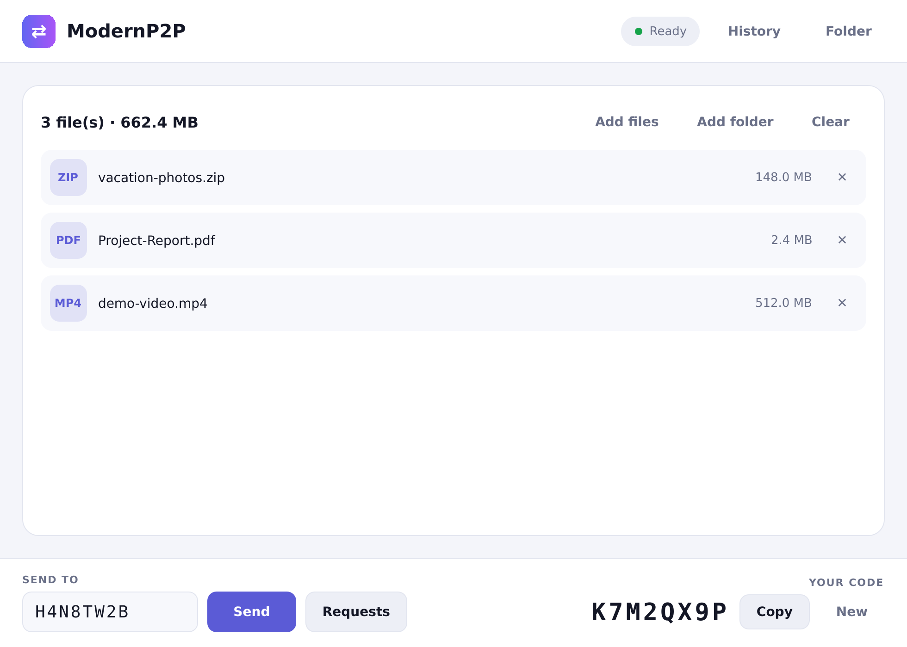
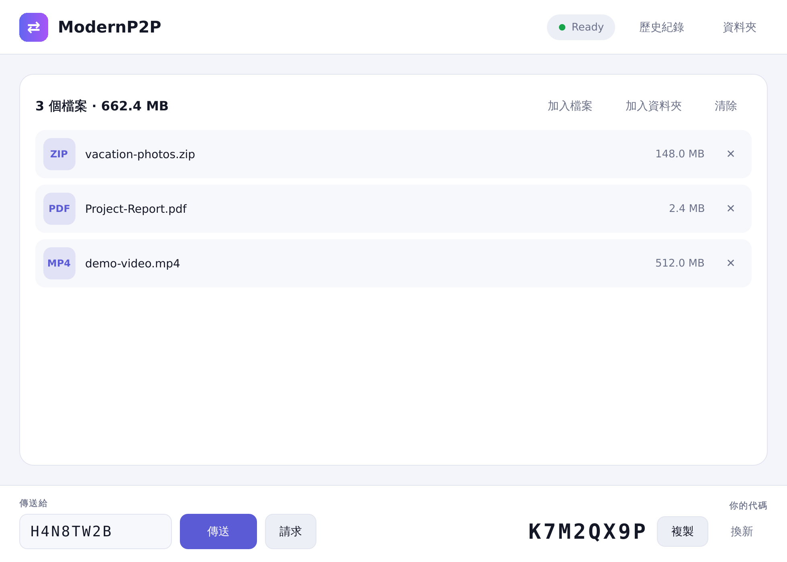
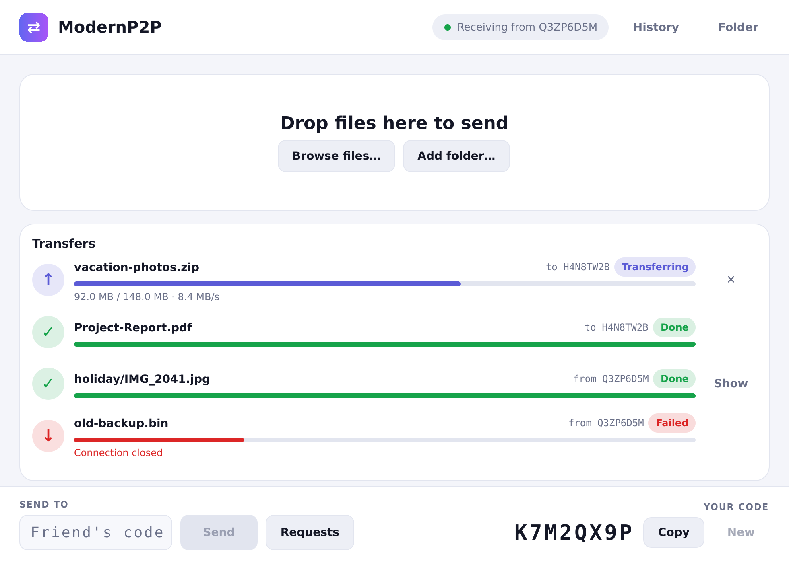
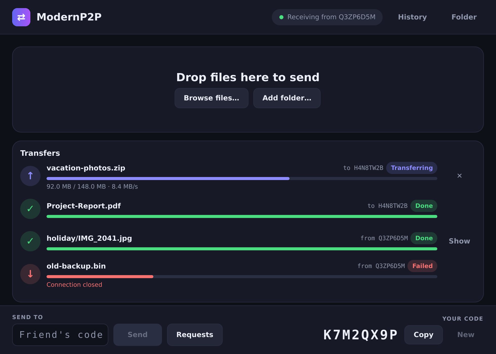
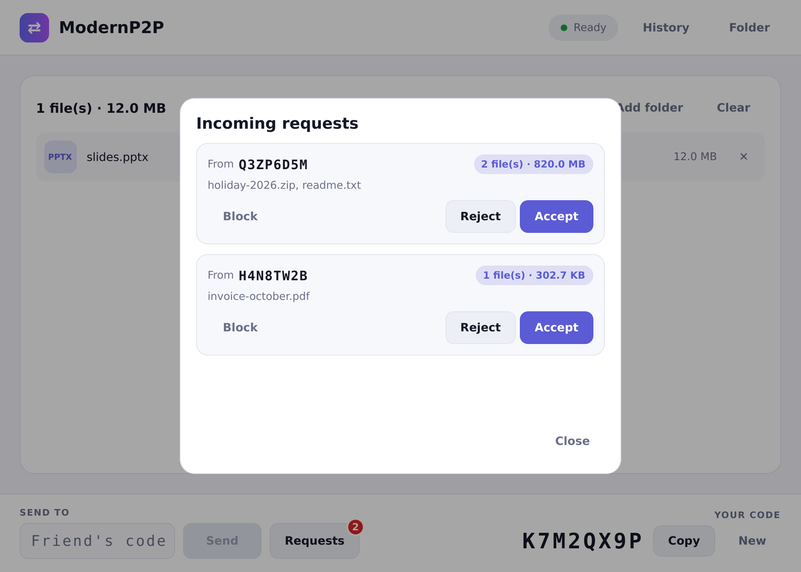
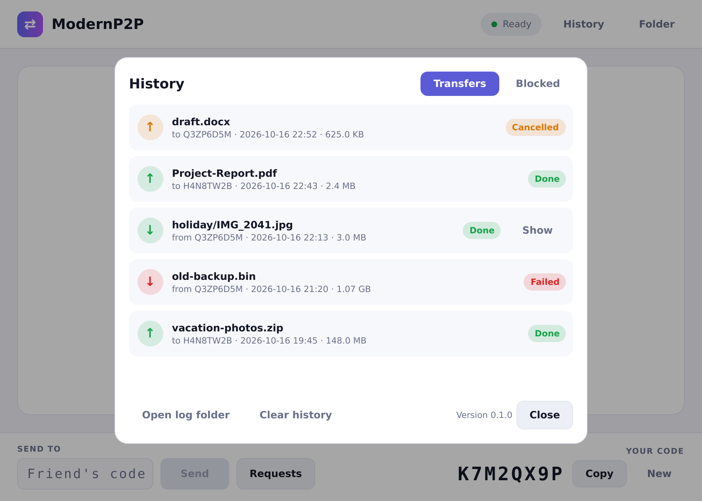
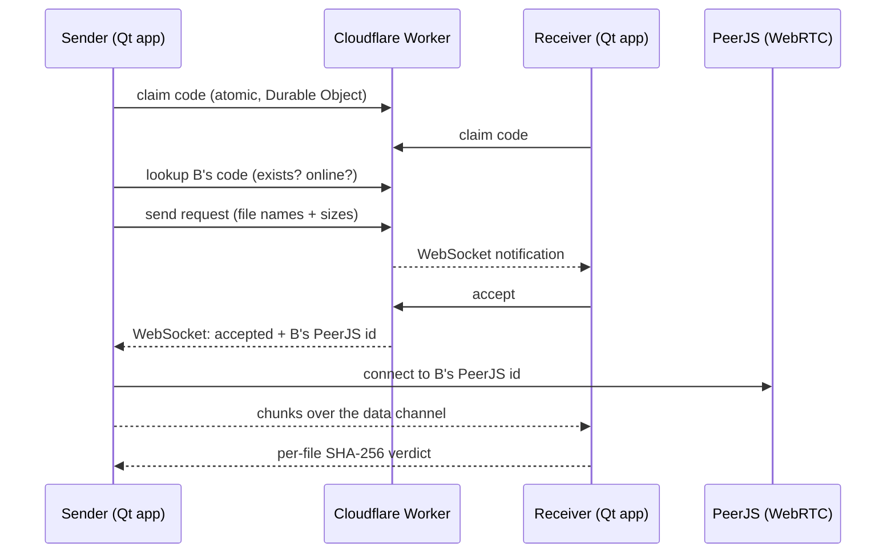

# ModernP2P

A Windows peer-to-peer file transfer app. Every device gets an 8-character code; type a
friend's code, they accept, and your files go straight to them over WebRTC.

Built with **Qt 6.11** (C++20, QML), a **Cloudflare Worker** (Durable Objects + KV) for codes and
notifications, and **PeerJS** for the transfer itself.

<p align="center">
  
  
</p>
<p align="center">
  
  
</p>
<p align="center">
  
  
</p>

> The screenshots are rendered from the real QML UI with demo data by
> [`tools/screenshots`](tools/screenshots) (Linux, software renderer), so fonts differ slightly
> from Windows. They are not captures of a live transfer.

## Features

- **Files and whole folders** (structure is kept; a folder never merges into an existing one)
- Per-file **SHA-256 verification**, progress, speed and cancel
- **Request / accept** flow with a file list preview; **block** unwanted codes
- **History** of finished transfers, with *Show in folder* for received files
- One-click **Copy** for your code, **New** code on demand
- Light / dark theme (follows the system) and **English / 繁體中文** (follows the system language)
- Rotating log file and a notice when a newer release is available on GitHub

## Using it

1. Start the app. On first launch it generates your **code** (bottom right) and registers it.
2. **Drop files or a folder** into the staging area (or use **Browse files…** / **Add folder…**).
3. Type the other person's code (bottom left) and press **Send**.
4. They see a notification on the **Requests** button, review the file list and **Accept**
   (or **Reject** / **Block**).
5. Files are streamed directly between the two computers, verified with SHA-256 and saved to
   `Downloads\ModernP2P` (change it with **Folder**). **Copy** puts your code on the clipboard and
   **New** gives you a fresh one.

History and the block list are under **History**; logs are in `%LOCALAPPDATA%\ModernP2P\logs`
(**History → Open log folder**). To force a language, set the `language` value (e.g. `zh_TW`) in the
app's settings (registry key `HKCU\Software\ModernP2P\ModernP2P`).

## How it works



- **Codes** are claimed atomically: each code is one Durable Object, so two devices can never
  get the same one. If a code is taken, the app silently generates another.
- The Worker maps a code to a **PeerJS id**, not an IP address. WebRTC does not need the IP, and
  handing it to anyone who knows a code would be a privacy leak. IPs are not stored.
- The receiver only accepts a connection from the exact peer id the Worker vouched for, presenting
  an accepted request id, once. File names come from the request the user accepted, never from
  the wire, and are sanitised for Windows (no path traversal, reserved names, illegal characters).
- Per-IP rate limits (KV) slow down code enumeration.

### Transfer protocol

JSON strings over a reliable PeerJS data channel, one file at a time:

| Direction | Message |
|---|---|
| sender → receiver | `{"t":"file","name","size"}` (`name` may be a relative path), `{"t":"chunk","d":<base64, 48 KiB>}`, `{"t":"end","sha":<hex>}` |
| receiver → sender | `{"t":"ack","ok":true}` or `{"t":"ack","ok":false,"reason"}` |

The receiver writes to `<name>.part` and renames it only after the size and SHA-256 match.
Names come from the request the user accepted, never from the wire, and every path component is
sanitised, so a sender cannot write outside the download folder.

## Repository layout

| Path | Purpose |
|---|---|
| `src/core` | Code generation, file-name sanitising, identity, logging, version comparison |
| `src/models` | Staging, requests, transfer, history and block list models |
| `src/network` | Worker client, notification WebSocket, update check |
| `src/transfer` | Transfer engine, transport interface and the PeerJS bridge (hidden WebEngine page) |
| `src/app` | `AppController` connecting everything to the UI |
| `src/qml`, `web/` | The UI and the PeerJS host page |
| `worker/` | Cloudflare Worker (TypeScript, Durable Object, KV rate limiting) |
| `resources/` | App icon (`icon.png`, `icon.ico`), generated by `tools/make_icon.py` |
| `tests/` | QtTest unit and integration tests (the transfer engine runs end to end over an in-process loopback) |
| `i18n/` | Translations (`ModernP2P_zh_TW.ts`) |
| `tools/screenshots` | Renders the README screenshots with demo data |
| `third_party/peerjs` | Vendored PeerJS 1.5.4 (MIT) |

## Setup

Repository **secrets** (Settings → Secrets and variables → Actions):

- `CF_API_TOKEN`: *Workers Scripts: Edit* and *Workers KV Storage: Edit*
- `CF_ACCOUNT_ID`

Repository **variable**:

- `API_BASE_URL`: the deployed Worker URL, e.g. `https://modernp2p-api.<subdomain>.workers.dev`
  (printed in the *Deploy* step of the Worker workflow). It is baked into the app at build time.

CI:

- `Build (Windows)`: builds with Qt 6.11.0, runs the tests, uploads `ModernP2P-win64.zip`.
- `Worker`: type-checks and tests on every PR; deploys to Cloudflare on pushes to `main`
  (it creates the KV namespace if it does not exist).
- `Release`: pushing a `v*` tag builds the app and publishes a GitHub release.

## Development

```sh
# App (Qt 6.11, MSVC)
cmake -S . -B build -DP2P_API_BASE=https://your-worker.workers.dev
cmake --build build --config Release
ctest --test-dir build -C Release --output-on-failure

# Worker
cd worker && npm ci && npm run typecheck && npm test

# Regenerate the screenshots (needs the QML modules; no WebEngine)
cmake -S . -B build-shots -DP2P_BUILD_APP=OFF -DP2P_BUILD_SCREENSHOTS=ON
cmake --build build-shots --target p2p_screenshots
QT_QPA_PLATFORM=offscreen QT_QUICK_BACKEND=software QT_SCALE_FACTOR=2 \
  build-shots/tools/screenshots/p2p_screenshots staged src/qml/Main.qml docs/screenshots/staged.png
```

The server URL can be overridden at runtime with the `MODERNP2P_API` environment variable.

## Trying it on one computer

You do not need a second PC. Run two independent copies side by side:

```bat
ModernP2P.exe --profile A
ModernP2P.exe --profile B
```

(or double-click `two-instances.bat` from the zip). Each profile has its own code, history, block
list and download folder (`Downloads\ModernP2P-A`, `...-B`), and the window title shows the profile.
Drop a file into **A**, type **B**'s code and press **Send**, then accept it in **B**.

## Testing

- `ctest`: code generation, file-name and path sanitising, models, history/block list persistence,
  logging and rotation, version comparison, and 11 transfer-engine scenarios (round trip, empty file,
  folders, corrupted chunk, wrong size, oversize data, path traversal, wrong peer, unknown request,
  cancel, completion signals).
- `worker`: `npm test` covers validation and limits; `npm run typecheck` checks the Worker.
- **End-to-end self-test**: `ModernP2P.exe --selftest [--selftest-out=result.txt]` runs two complete
  devices in one process over the real network: claim codes on the Worker, register with PeerJS, send
  a request, receive the WebSocket notification, accept, transfer 3 MB plus a folder over WebRTC and
  compare the bytes. CI runs it on every build (non-blocking, since it depends on third-party
  services). It needs `API_BASE_URL` for the Worker part; without it only the PeerJS/WebRTC part runs.
- Self-hosting / offline: set `MODERNP2P_PEERJS=host:port[/path]` (optionally `http://` or `https://`)
  to use your own PeerJS server (`npx peer --port 9000`) and `MODERNP2P_API=http://127.0.0.1:8787` to
  point at a local `wrangler dev`. The whole self-test was run locally this way.
- Not covered by automated tests: the interaction of the QML UI with a real window (copy button,
  file dialogs).

## Limitations

- No resume after a dropped connection (the partial file is discarded and the transfer fails).
- No extra file-level encryption: WebRTC data channels are already encrypted (DTLS) between the peers.
- No system tray icon; the taskbar button flashes when a request arrives.
- The update check only tells you a newer release exists; it does not install it.
- Error details shown under a failed file are in English.
- Uses PeerJS's public signalling server and a public STUN server; some strict NATs need a TURN server.
- The ownership token for your code is stored in the current user's registry hive.
