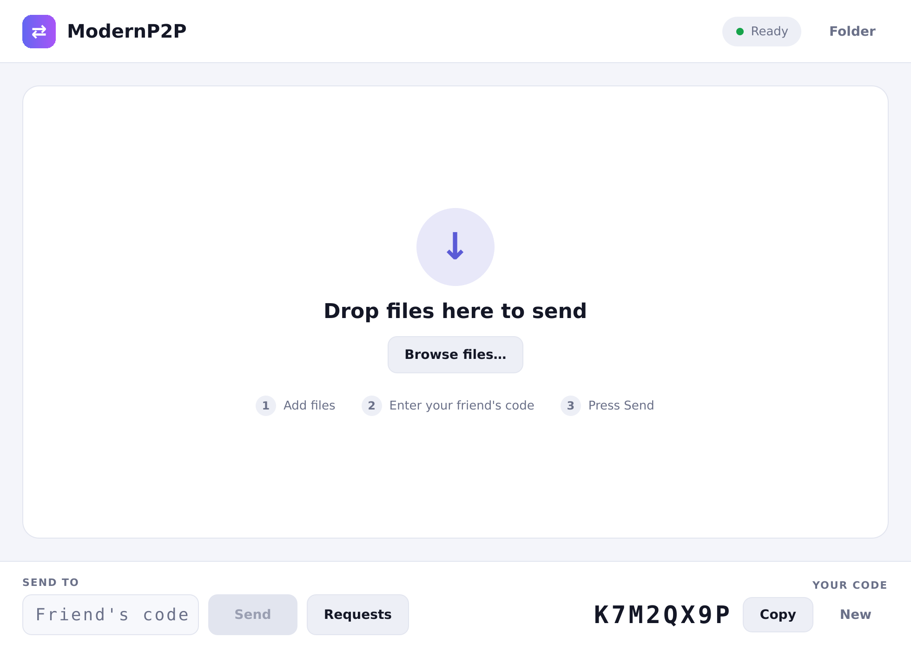
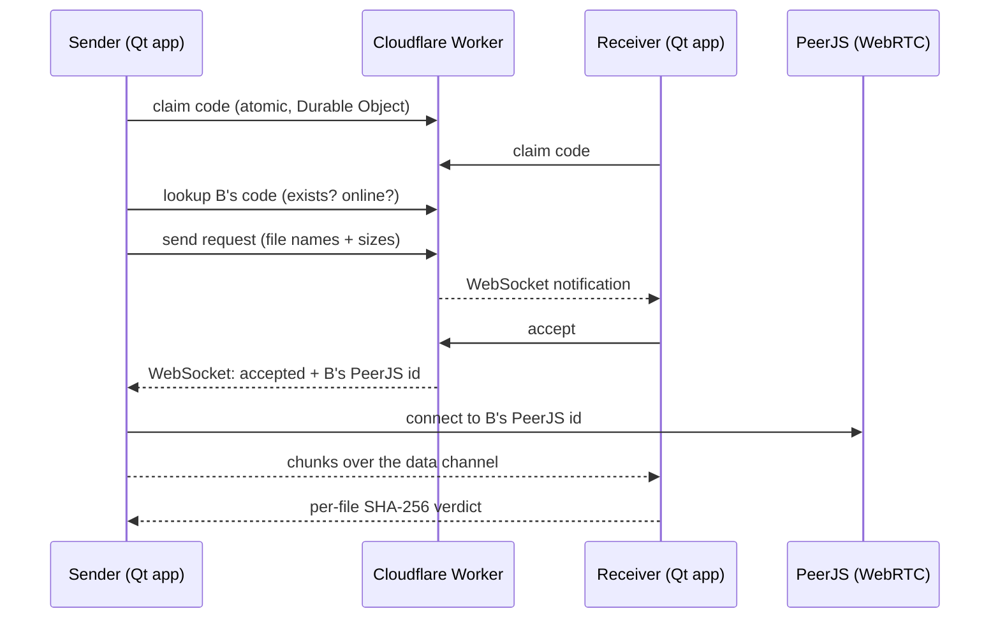

# ModernP2P

A Windows peer-to-peer file transfer app. Every device gets an 8-character code; type a
friend's code, they accept, and your files go straight to them over WebRTC.

Built with **Qt 6.11** (C++20, QML), a **Cloudflare Worker** (Durable Objects + KV) for codes and
notifications, and **PeerJS** for the transfer itself.

<p align="center">
  
  
</p>
<p align="center">
  
  
</p>

> The screenshots are rendered from the real QML UI with demo data by
> [`tools/screenshots`](tools/screenshots) (Linux, software renderer), so fonts differ slightly
> from Windows. They are not captures of a live transfer.

## Using it

1. Start the app. On first launch it generates your **code** (bottom right) and registers it.
2. **Drop files** into the staging area (or press **Browse files…**).
3. Type the other person's code (bottom left) and press **Send**.
4. They see a notification on the **Requests** button, review the file list and **Accept**.
5. Files are streamed directly between the two computers, verified with SHA-256 and saved to
   `Downloads\ModernP2P` (change it with **Folder**). **Copy** puts your code on the clipboard and
   **New** gives you a fresh one.

The UI follows the system light/dark setting.

## How it works



- **Codes** are claimed atomically: each code is one Durable Object, so two devices can never
  get the same one. If a code is taken, the app silently generates another.
- The Worker maps a code to a **PeerJS id**, not an IP address. WebRTC does not need the IP, and
  handing it to anyone who knows a code would be a privacy leak. IPs are not stored.
- The receiver only accepts a connection from the exact peer id the Worker vouched for, presenting
  an accepted request id, once. File names come from the request the user accepted, never from
  the wire, and are sanitised for Windows (no path traversal, reserved names, illegal characters).
- Per-IP rate limits (KV) slow down code enumeration.

### Transfer protocol

JSON strings over a reliable PeerJS data channel, one file at a time:

| Direction | Message |
|---|---|
| sender → receiver | `{"t":"file","name","size"}`, `{"t":"chunk","d":<base64, 48 KiB>}`, `{"t":"end","sha":<hex>}` |
| receiver → sender | `{"t":"ack","ok":true}` or `{"t":"ack","ok":false,"reason"}` |

The receiver writes to `<name>.part` and renames it only after the size and SHA-256 match.

## Repository layout

| Path | Purpose |
|---|---|
| `src/core` | Code generation, file-name sanitising, persisted identity |
| `src/models` | Staging, requests and transfer list models |
| `src/network` | Worker client and notification WebSocket |
| `src/transfer` | PeerJS bridge (hidden WebEngine page) and the transfer engine |
| `src/app` | `AppController` connecting everything to the UI |
| `src/qml`, `web/` | The UI and the PeerJS host page |
| `worker/` | Cloudflare Worker (TypeScript, Durable Object, KV rate limiting) |
| `resources/` | App icon (`icon.png`, `icon.ico`), generated by `tools/make_icon.py` |
| `tests/` | QtTest unit tests |
| `tools/screenshots` | Renders the README screenshots with demo data |
| `third_party/peerjs` | Vendored PeerJS 1.5.4 (MIT) |

## Setup

Repository **secrets** (Settings → Secrets and variables → Actions):

- `CF_API_TOKEN`: *Workers Scripts: Edit* and *Workers KV Storage: Edit*
- `CF_ACCOUNT_ID`

Repository **variable**:

- `API_BASE_URL`: the deployed Worker URL, e.g. `https://modernp2p-api.<subdomain>.workers.dev`
  (printed in the *Deploy* step of the Worker workflow). It is baked into the app at build time.

CI:

- `Build (Windows)`: builds with Qt 6.11.0, runs the tests, uploads `ModernP2P-win64.zip`.
- `Worker`: type-checks and tests on every PR; deploys to Cloudflare on pushes to `main`
  (it creates the KV namespace if it does not exist).
- `Release`: pushing a `v*` tag builds the app and publishes a GitHub release.

## Development

```sh
# App (Qt 6.11, MSVC)
cmake -S . -B build -DP2P_API_BASE=https://your-worker.workers.dev
cmake --build build --config Release
ctest --test-dir build -C Release --output-on-failure

# Worker
cd worker && npm ci && npm run typecheck && npm test

# Regenerate the screenshots (needs the QML modules; no WebEngine)
cmake -S . -B build-shots -DP2P_BUILD_APP=OFF -DP2P_BUILD_SCREENSHOTS=ON
cmake --build build-shots --target p2p_screenshots
QT_QPA_PLATFORM=offscreen QT_QUICK_BACKEND=software QT_SCALE_FACTOR=2 \
  build-shots/tools/screenshots/p2p_screenshots staged src/qml/Main.qml docs/screenshots/staged.png
```

The server URL can be overridden at runtime with the `MODERNP2P_API` environment variable.

## Limitations

- Individual files only (no folders yet) and no resume after a dropped connection.
- Uses PeerJS's public signalling server and a public STUN server; some strict NATs need a TURN server.
- The ownership token for your code is stored in the current user's registry hive.
